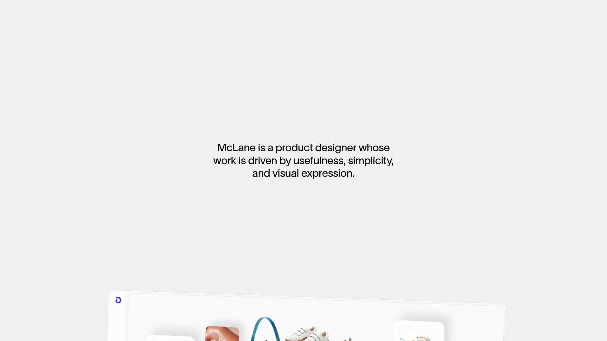

# DESIGN.md: mc1ane-inspired Hex hero

## Source

- URL: https://www.mc1ane.com
- Capture date: 2026-08-27
- Evidence: Firecrawl branding/images scrape, Firecrawl screenshot, and source HTML inspection

## Reference Screenshot

Use this screenshot as the visual source of truth for the hero's scale, whitespace, centered hierarchy, and quiet feel. The source's portfolio content is not being copied; only the visual language is being adapted for Hex.

## Design Summary

The reference is a full-viewport, pale-gray canvas with one centered statement in lightweight black typography. It relies on restraint, generous empty space, and a nearly invisible frame rather than navigation chrome, cards, gradients, or decorative imagery.

## Design Tokens

### Colors

- Canvas: `#EFEFEF` (observed)
- Primary text: `#111111` (observed)
- Strong text: `#000000` (observed)
- Subtle border: `rgba(0, 0, 0, 0.05)` (observed)

### Typography

- Source family: `TWKLausannePan` (observed)
- Local fallback for Hex: `ClashGrotesk-Variable.ttf`
- Hero statement: approximately `34px`, weight `300`, line-height `1.18` on desktop (observed)
- Keep copy centered, short, and sentence case. Avoid display effects, gradients, and all-caps labels.

### Spacing And Layout

- Full viewport hero with `min-height: 100dvh`
- Center the statement both horizontally and vertically, with a slight optical lift
- Constrain the statement to roughly `560–640px`
- Keep the brand mark and GitHub link quiet at the top edge
- No image, card, shadow, faux window, or secondary section

## Components

- Minimal top bar: retained Hex mark on the left and GitHub icon/link on the right
- Centered hero statement: one short paragraph describing the product
- Inline download action: Apple logo plus text, treated as a quiet text link rather than a large button

## Page Patterns

- One hero section only
- Desktop: centered statement with generous negative space
- Mobile: same centered composition, smaller type, tighter side padding
- Use a subtle fade/translate entrance only; respect `prefers-reduced-motion`

## Content Style

Plain, confident, and specific. The copy should describe what Hex does in one sentence and avoid marketing cliches, feature lists, and repeated calls to action.

## Agent Build Instructions

Recreate the source's quiet composition rather than its portfolio content. Keep the page almost empty on purpose: a pale gray background, one centered Hex statement, and a small top bar. Use local typography, inline SVG logos, no external imagery, no gradients, no pill buttons, no heavy shadows, and no additional sections.

## Rerun Inputs

workflow: firecrawl-website-design-clone
source_url: https://www.mc1ane.com
target_stack: Vite + vanilla HTML/CSS
output: DESIGN.md
